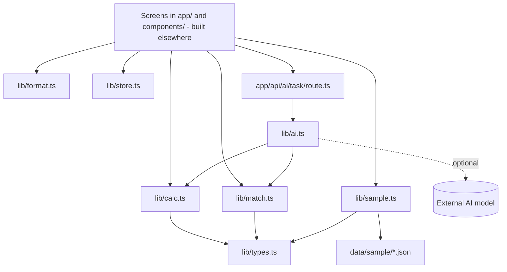

# Design Document

## Overview

A set of pure TypeScript modules in `lib/`, JSON files in `data/sample/`, and one API route. Screens (built elsewhere) import these modules. The modules do not touch `app/` pages or `components/`. All formulas, sample numbers and the data model come from `.kiro/specs/poolrx/design.md`, which wins if the two documents disagree.

Not in this spec: `lib/feed-types.ts`, `lib/ndc.ts`, `lib/feeds.ts`, `data/cache/*`, `scripts/fetch-feeds.ts`, `app/api/feeds/*` (live-data work), and everything in `components/` and the page files in `app/` (UI work).

## Architecture

Key decisions:
- Pure functions with plain object inputs, so screens and tests can call them without a server.
- The Calculator takes NADAC as a plain number per drug. The caller passes the live value or `nadacFallback`.
- Money is kept as numbers in dollars. Rounding happens only in `lib/format.ts` and where the formulas say "round".
- Matching is rule-based (normalized text, edit distance, synonym table, brand-to-generic table) and never calls the network.
- One wrapper makes the AI call and always returns a valid `AiResult`, using the Fallback on any problem.

## Components and Interfaces

| File | Purpose | Main exports |
|---|---|---|
| `lib/types.ts` | Shared types | `Drug`, `Round`, `Quote`, `UploadRow`, `ColumnMapping`, `DrugMatch`, `AiResult`, `SwapDecision`, `OptIn` |
| `lib/format.ts` | Display helpers | `formatDollars`, `formatPercent`, `formatSavings` |
| `lib/store.ts` | Demo state | `Store`, `createLocalStore`, `createMemoryStore` |
| `lib/sample.ts` | Sample data loader | `loadSample()` |
| `lib/calc.ts` | All calculations | `annualSpend`, `gapPct`, `savingsRange`, `daysOfSupply`, `shortageRisk`, `recommendedCommitment`, `scoreSuppliers`, `roundProgress`, `summaryFigures`, `monthlySeries` |
| `lib/match.ts` | Upload matching | `parseUpload`, `mapColumns`, `matchDrugs` |
| `lib/ai.ts` | AI wrapper + fallbacks | `runAiTask` |
| `app/api/ai/[task]/route.ts` | HTTP route | `POST` |

## Data Models

Types follow the data model in `.kiro/specs/poolrx/design.md`:
- `Drug` = id, name, strength, form, category, ndc?, mfr, unitsPerMonth, paid, onHand?, countDate?, hasShortage (sample flag), nadacFallback.
- `Round` = id, name, status (open | target | quotes | awarded | closed | at-risk | missed), estRange, targetUnits, committedUnits, pharmacies, deadline, confirmDeadline?, drugs, pastConfirmRate.
- `Quote` = supplier (A | B | C), prices by product, deliveryDays, minOrder, reliability, quotedPct.
- `MatchStatus` = matched | needs-review | unmatched.
- `AiResult` = task, result, confidence, source (ai | fallback), sourceNote.
- Sample files each carry `"kind": "sample"`.

The Feed Types (`Benchmark`, `Equivalent`, `Shortage`, `FeedStatus`) are defined in `lib/feed-types.ts` by the live-data work and are not redefined here.

## Correctness Properties

### Property 1: Savings range
For all inputs, the low savings value is at most the high value, and both are at least 0. **Validates: Requirements 3.11**

### Property 2: Supplier ranking
For all quote sets and weights, supplier totals stay between 0 and 100, and reordering the input does not change the winner. **Validates: Requirements 3.12**

### Property 3: Days of supply
More units on hand with the same usage never lowers days of supply. **Validates: Requirements 3.13**

### Property 4: No NaN
For all inputs, calculator outputs are finite numbers or an explicit "not available" result. **Validates: Requirements 3.14**

### Property 5: Known NDC match
A row with an NDC that exists in the catalog is always matched with confidence 100. **Validates: Requirements 4.7**

### Property 6: AI fallback
For all tasks, with no key set, the result is a valid `AiResult` with source "fallback". **Validates: Requirements 5.4**

## Error Handling

- The sample loader throws an error naming the file and the failing field.
- The Calculator returns an explicit "not available" result instead of NaN or Infinity.
- The Matcher returns an error object naming the file and how to fix it.
- The AI route returns HTTP 400 for an invalid body and a Fallback result for every other failure.

## Testing Strategy

- Vitest unit tests for each module, using the numbers in `.kiro/specs/poolrx/design.md`.
- fast-check property tests for the properties above.
- Matcher tests use the demo headers and the five demo drug names.
- The AI route test runs with no key and checks that every task returns a Fallback result.
- Gate before finishing: `npx vitest --run`, `npx tsc --noEmit` and `npm run build` pass.
